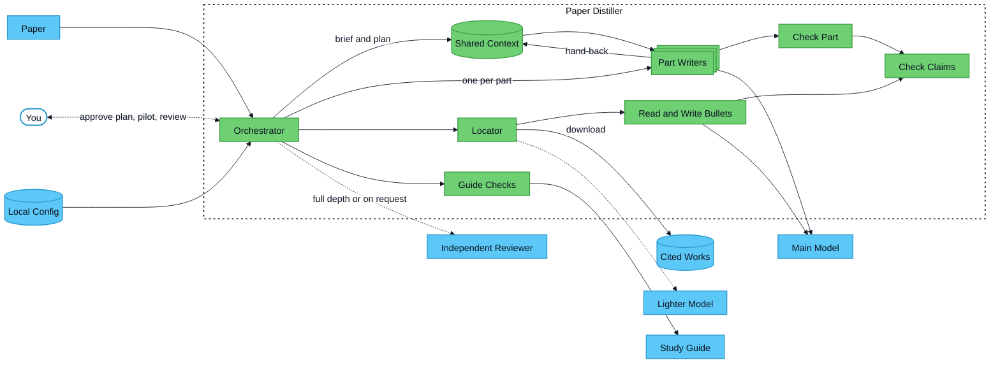

# research-paper-distilled

A Claude Code skill that turns one research paper, or one technical web article, into a study guide. A junior engineer can learn from the guide without opening the source.

The guide covers the claim, the method, each derivation worked one step at a time, the source's own figures and tables, the metrics, the limits and the key references. Before delivery, scripts check every number, quote and calculation against the source. They also check every link and cross-reference in the guide.

The skill handles three kinds of source:

- **Research papers**: a PDF or an arXiv link. The skill picks a mode from the paper's main contribution: empirical, theory, survey, systems or method.
- **Tutorials**: a blog post or lecture notes that teach an existing technique.
- **Engineering posts**: a company blog post about its own system, outage or setup, such as a post on load balancing, system design or DevOps. These use the mechanism, incident or how-to mode.

## Architecture



## Requirements

| Tool | Used for | Check |
|---|---|---|
| Claude Code | runs the skill | `claude --version` |
| Python 3.9 or later | every script; standard library only | `python3 --version` |
| poppler (`pdftotext`, `pdftoppm`, `pdfinfo`) | reads and crops PDF pages | `pdftotext -v` |
| Google Chrome or Chromium | prints the guide and web pages to PDF | see the note below |
| Node.js 22.13 or later, with `npx` | diagrams and Markdown parts | `node --version` |

Install poppler with `brew install poppler` on macOS, or `sudo apt-get install poppler-utils` on Debian and Ubuntu.

The scripts look for Chrome in its default place. If Chrome is somewhere else, set `CHROME_PATH` to its full path.

The first diagram downloads `@mermaid-js/mermaid-cli@12.0.0` into the npm cache. The first Markdown part installs `katex@0.16.11` and `marked@12.0.2` into `~/.cache/research-paper-distilled`. Both steps need network access once.

## Install

The plugin and the plain skill use the same name, so only one of them loads. Install the skill in one way only.

### As a plugin (recommended)

From your shell, on Claude Code 2.1.292 or later:

```bash
claude plugin install research-paper-distilled --marketplace abhisheksharma026/research-paper-distilled
```

Or inside a Claude Code session, on version 2.1.275 or later:

```text
/plugin install research-paper-distilled --marketplace abhisheksharma026/research-paper-distilled
```

On an older version, add the marketplace first and then install:

```bash
claude plugin marketplace add abhisheksharma026/research-paper-distilled
claude plugin install research-paper-distilled@research-paper-distilled
```

### As a plain skill

Clone the repository into your personal skills folder. The skill then works in every project:

```bash
git clone https://github.com/abhisheksharma026/research-paper-distilled.git ~/.claude/skills/research-paper-distilled
```

To use the skill in one project only, clone it into the `.claude/skills/research-paper-distilled` folder of that project.

After either install, start a new Claude Code session. The skill shows in the list of available skills as `research-paper-distilled`.

## First run

On the first run, the skill asks three questions. It saves the answers in `~/.config/research-paper-distilled/config.json`:

1. **The reviewer for the independent review**: a fresh agent of the same model (recommended), an installed review agent, a command you name, or no review.
2. **The output folder** for guides (default `~/Research-Papers/`).
3. **The model that finds passages in cited works**: the session's model (recommended) or a lighter one.

The file holds your choices only, never a key or a token. To change a choice, edit the file or ask the skill. The skill writes review lessons from your own guides to `~/.config/research-paper-distilled/review-findings.md`. Both files stay on your machine, and this repository never contains them.

## Use

Ask for a guide in plain words and name the source:

```text
Make a study guide of arXiv 1706.03762.
Distill https://blog.cloudflare.com/eliminating-hardware-with-load-balancing-and-cloudflare-one/ for a junior software engineer.
```

The skill asks four intake questions: the length, the reader, the pilot and the depth of the review. The pilot is a short sample of two or three parts that you approve before the full build. Then the skill shows a plan for you to approve. It builds the guide one part at a time and runs the checks. At the end, it gives you the paths of the PDF and of its HTML source.

Start each guide in a new session. A long session makes every later step more expensive.

## Update

Claude Code does not update this plugin by itself. To update the plugin, run:

```bash
claude plugin update research-paper-distilled@research-paper-distilled
```

To get updates automatically, turn on auto-update for this marketplace under `/plugin`, Marketplaces.

To update the plain skill, run:

```bash
git -C ~/.claude/skills/research-paper-distilled pull
```

## Uninstall

To remove the plugin, run:

```bash
claude plugin uninstall research-paper-distilled@research-paper-distilled
```

To remove the plain skill, delete the `~/.claude/skills/research-paper-distilled` folder.

Neither step deletes your settings or your review lessons. To remove them too, delete `~/.config/research-paper-distilled/`.

## Layout

| Path | Holds |
|---|---|
| `SKILL.md` | the workflow and the guide contract that Claude follows |
| `references/` | the rules that each step reads: intake, modes, writing, voice, layout, evidence, verification |
| `scripts/` | the fetchers, the extractors, the build and the checks; each script lists its inputs at the top |
| `assets/` | the part skeletons and the guide stylesheet |
| `.claude-plugin/` | the plugin manifest and the marketplace file that the plugin install reads |

## License

MIT. See `LICENSE`.
